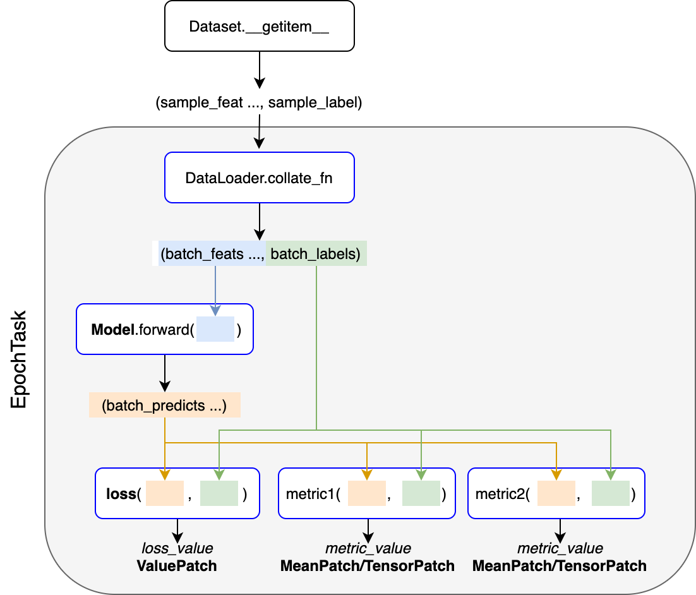

# 定制训练流程

默认的 `Trainer` 已包含模型调用、损失计算和参数更新。需要在特定时机执行操作时，可以使用 Callback；需要改变每批计算方式时，可以定制步骤；需要特殊指标汇总方法时，可以定制 Patch。

## Callback：在训练事件中执行操作

初始化模型参数、记录每轮结果、检查停止条件，都需要在训练的特定时机执行。`Callback` 提供这些事件入口：继承它并实现需要的方法，再将实例传给 `Trainer(callbacks=...)`。例如，`on_before_fit` 在训练开始前执行，`on_after_epoch` 在每轮结束后执行，[自定义回调示例](../examples/14-costomize-callback.py) 展示了具体写法。

分布式训练会在初始化回调完成后同步模型参数与 buffer，使各进程从相同模型状态开始。

## TrainerBase 与 EpochTask：定义每批计算

一个 batch 需要多次调用模型，或者训练、验证、测试需要不同的计算方式时，可以自定义步骤方法。继承 `TrainerBase`，适合为所有数据集定义共用步骤；继承 `EpochTask`，适合为某个数据集定义特有步骤。

如果多个数据集需要分别执行，`EpochTask(dataloader, name=None, max_batches=None, **step_args)` 可以把一个 DataLoader、指标和步骤参数组织为一项训练、验证或测试任务。`name` 为最终指标增加 `name/` 前缀，`max_batches` 设置该任务每次执行的本地 batch 上限，接受正整数或 `None`。继承它还可以为不同任务定义各自的步骤。

步骤方法包括通用的 `step`、阶段专用的 `train_step`、`val_step`、`test_step`，以及验证与测试共用的 `evaluate_step`。它们接受 `(batch_x, batch_y, **step_args)`，返回 None 或 `{指标名: Patch对象}`。单个输入通过 `self.model(batch_x)` 调用模型；多个输入使用 `self.model(*batch_x)`，字典输入使用 `self.model(**batch_x)`。

在 `EpochTask` 的步骤中，可以直接使用 `self.model`、`self.loss`、`self.device`、`self.optimize` 和 `self.do_metric` 等训练器入口。Task 未定义的属性从所属训练器查找；两者都不存在时抛出 `AttributeError`，指出缺失的属性名。

方法选择先比较方法名，再比较定义位置：通用 `step` 优先于阶段专用方法，查找同名方法时先用 Task 的实现。下表中的 Task 表示当前 `EpochTask`，Trainer 表示训练器，每行从左向右查找，找到后即执行：

| 阶段 | 查找顺序 |
| --- | --- |
| 训练 | `Task.step` → `Trainer.step` → `Task.train_step` → `Trainer.train_step` |
| 验证 | `Task.step` → `Trainer.step` → `Task.val_step` → `Trainer.val_step` → `Task.evaluate_step` → `Trainer.evaluate_step` |
| 测试 | `Task.step` → `Trainer.step` → `Task.test_step` → `Trainer.test_step` → `Task.evaluate_step` → `Trainer.evaluate_step` |

例如，同时定义 `Trainer.step` 和 `Task.train_step` 时，训练执行 `Trainer.step`。创建 `EpochTask` 时提供的额外关键字参数会传给选中的步骤方法。

一个阶段可以安排多个 `EpochTask`，各任务分别计算自己的指标。使用任务列表时，`train_dl` 与 `train_tasks` 二选一，`val_dl` 可以与 `val_tasks` 合并，`test_dl` 可以与 `tasks` 合并。合并在本次调用的独立列表中完成，传入的任务列表可在多次调用中复用。[自定义训练器示例](../examples/15-customize-steps-1.py) 与[自定义任务示例](../examples/16-customize-steps-2.py) 分别展示了两种组织方式。

自定义步骤通过 `self.model` 调用模型，通过 `self.loss` 将损失计算交给训练器。在训练阶段，`self.loss(...)` 会计算并返回标量损失、执行反向传播，并默认记录当前批次指标。参数更新遵循梯度累积配置，实际更新后清空相应优化器的梯度。最小的训练步骤可以写成：

```python
from deepepochs import TrainerBase


class CustomTrainer(TrainerBase):
    def train_step(self, batch_x, batch_y, **step_args):
        predictions = self.model(batch_x)
        # 计算损失并反向传播，按累积配置更新参数，同时记录指标。
        self.loss(predictions, batch_y)
```

这行 `self.loss(...)` 已经执行本次反向传播。设置 `do_optimize=False` 只推迟参数更新，仍然计算损失并反向传播；随后用 `self.optimize(optimize_index=...)` 选择优化器并请求更新。启用跨 batch 累积时，参数在窗口末实际更新。验证和测试中的 `self.loss(...)` 计算损失与指标，不反向传播或更新参数；`do_loss=False` 时仅处理指标。

累积多个 DataLoader batch 时，直接设置 `gradient_accumulation_steps` 即可，[跨批累积示例](../examples/23-grad_accumulate-2.py) 展示了完整用法。需要自行切分一个 batch 时，普通逐样本平均损失的每个子 batch 使用 `loss_adjust=子批样本数 / 整批样本数`，并设置 `do_optimize=False, do_metric=False`。全部子批反向传播后调用 `self.optimize()`，再用 `self.do_metric(整批平均损失, 整批预测, 整批标签)` 记录指标。非末子批的前向和反向放在 `self.no_sync()` 中，单进程也可使用。[手动子批示例](../examples/22-grad_accumulate-1.py) 展示了这一进阶流程。

步骤和回调中的普通异常会向调用方传播。返回值不符合步骤约定、监控指标不存在等接口或配置错误同样会抛出异常，便于从错误信息和堆栈定位。训练循环中需要主动结束时，可以抛出 `StopLoopException`；早停也通过这一停止信号结束训练。

## Patch：定义指标汇总方式

步骤方法按 batch 返回结果，任务结束后还需要把这些结果合成整个数据集的指标。返回 Patch 对象，就能将用于汇总的数据及其计算方法一并交给训练器。例如，`TensorPatch` 保存预测和标签，`ValuePatch` 保存已计算的批均值与样本数。`TensorPatch`、`MeanPatch` 与 `ValuePatch` 保存的统计数据均与训练计算图分离。

需要特殊汇总方式时，继承 `PatchBase` 并实现 `load`、`add` 和 `forward`。`load` 装载当前 batch 数据并返回自身，`add` 合并状态，`forward` 返回最终指标或字典。[自定义 Patch 示例](../examples/20-customize-patch.py) 展示了完整实现。

图示为 tuple/list batch 中输入与标签分开的数据流。`EpochTask` 从 DataLoader 读取 batch，调用模型获得预测，再将损失和指标装入对应 Patch。任务结束时，各 Patch 计算汇总结果，形成阶段指标字典。



## 定制逐批预测

`predict` 使用独立的 `predict_step(batch_x)`，默认把完整 batch 传给模型。输入中包含标签、样本 ID 等附加数据时，可以在步骤中自行拆分，并把预测和 ID 一起返回：

```python
from deepepochs import TrainerBase


class PredictionTrainer(TrainerBase):
    def predict_step(self, batch_x):
        features, sample_ids = batch_x
        return {'ids': sample_ids, 'predictions': self.model(features)}
```

返回值中的 Tensor 会逐批复制到 CPU。预测生成器的使用、提前关闭与分布式结果顺序见[数据与指标](data-and-metrics.md)。

## 流式汇总 Patch

`deepepochs.patches.PatchAccumulator(context)` 提供 `add(patch_dict)` 和 `compute()`。训练器逐批调用 `add`，任务结束时调用 `compute` 获取指标。内置的均值、数值和混淆矩阵 Patch 累计汇总状态，分布式任务结束时通过张量归约合并；`TensorPatch` 与自定义 Patch 使用通用汇总路径，保留其数据与计算语义。`aggregate_patch_dicts` 可用于一次汇总已有的 Patch 字典列表。

---

[返回首页](../README.md) · [数据与指标](data-and-metrics.md) · [训练配置](training.md) · [日志与可视化](logging.md)
